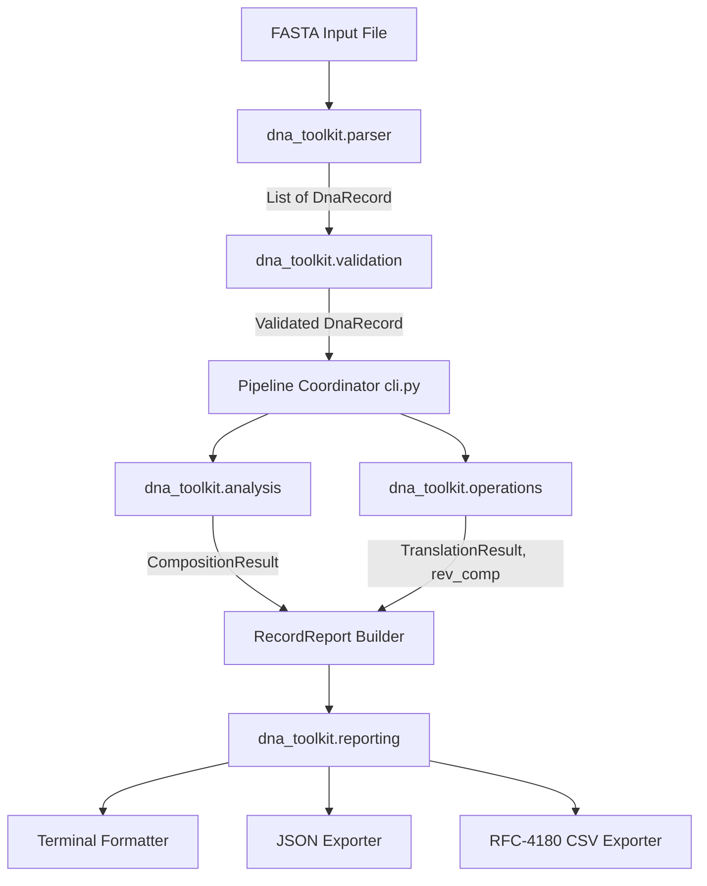

# Architecture and Technical Design

## 1. System Overview

The **DNA Sequence Analysis Toolkit** (`dna-toolkit`) is structured as a pipeline of independent, single-responsibility modules following the Python `src` layout. It ingests biological sequence data in standard FASTA format, normalizes and validates it against explicit biological policies, performs nucleotide and codon calculations, and dispatches formatted outputs to stdout or disk.

---

## 2. Module Responsibilities

| Module | Primary Responsibility | Key Types / Classes | Exceptions Handled & Raised |
| :--- | :--- | :--- | :--- |
| `parser.py` | Streaming and extraction of FASTA headers, descriptions, and sequence lines. | `DnaRecord` | `FastaFileNotFoundError`, `EmptyFastaError`, `MalformedFastaError` |
| `validation.py` | Enforcing sequence grammar, base validity, case normalization, and ID uniqueness. | `ValidationMode` (`STRICT`, `AMBIGUOUS`) | `EmptySequenceError`, `InvalidBaseError`, `DuplicateRecordError` |
| `analysis.py` | Frequency metrics, sequence length, GC calculations, and composition reconciliation. | `CompositionResult` | `EmptySequenceError`, `ValueError` (reconciliation failure) |
| `operations.py` | Antiparallel reverse-complementation, direct strand complementation, and 6-frame translation. | `TranslationResult` | `ValueError` (invalid frame/table) |
| `reporting.py` | Multi-target serialization (human-readable text, structured JSON, tabular CSV) with atomic write safety. | `RecordReport` | `PermissionError`, `OSError` |
| `cli.py` | CLI parsing, argument validation, pipeline orchestration, and system exit code assignment. | `argparse.ArgumentParser` | Translates domain errors to exit codes 0, 1, 2, 3 |

---

## 3. Key Design Decisions and Rationale

### A. The `src` Layout Pattern
- **Decision**: Code is organized inside `src/dna_toolkit/` rather than a flat root package.
- **Rationale**: Prevents accidental imports of local working directories over installed packages during testing. Ensures `pytest` exercises the installed editable package metadata specified in `pyproject.toml`.

### B. Immutable Domain Objects (`@dataclass(frozen=True)`)
- **Decision**: `DnaRecord`, `CompositionResult`, and `TranslationResult` are immutable dataclasses.
- **Rationale**: Biological data pipelines often run batch operations. Preventing in-place mutation guarantees thread-safety and referential transparency: an analyzed record cannot have its sequence altered accidentally between the analysis and reporting phases.

### C. Explicit Separation of Parser vs. Validator
- **Decision**: The FASTA parser preserves exact sequence strings without filtering invalid bases; validation is performed in a separate module.
- **Rationale**: File parsing and biological validation have different concerns. A parser should faithfully read whatever characters exist in the file. Silently stripping unknown characters during parsing corrupts coordinates and hides sequencing errors. The validator reports exact invalid characters and their 1-based indices.

### D. Direct Complement vs. Reverse Complement
- **Decision**: Expose both `complement()` and `reverse_complement()` as distinct functions.
- **Rationale**: DNA strands are antiparallel ($5' \to 3'$ and $3' \to 5'$). In bioinformatics, sequences are universally represented $5' \to 3'$. Direct complement produces the antiparallel strand running $3' \to 5'$. To obtain the biological sequence of the opposing strand in standard $5' \to 3'$ orientation, one must compute the *reverse complement*. Confusing these two operations is one of the most common beginner errors in bioinformatics.

### E. Defensive Translation and Partial Codon Trimming
- **Decision**: Explicitly compute `len(subseq) % 3` and slice to complete triplets prior to calling Biopython's translation engine, recording `partial_bases_trimmed`.
- **Rationale**: Arbitrary FASTA fragments (e.g. genomic contigs) are not guaranteed to be complete Coding DNA Sequences (CDS). Trimming trailing partial codons prevents unexpected runtime warnings while informing the researcher exactly how many bases were excluded.

---

## 4. Exit Code Contract

The CLI enforces standard POSIX / sysexits-aligned process return codes:
- **`0`**: `EXIT_SUCCESS` — Workflow completed successfully.
- **`1`**: `EXIT_DATA_ERROR` — Malformed FASTA input, invalid nucleotide characters, empty sequence, or duplicate identifiers.
- **`2`**: `EXIT_ARG_ERROR` — Missing required arguments or invalid command-line flag syntax.
- **`3`**: `EXIT_IO_ERROR` — File not found or permission denied on read/write.
